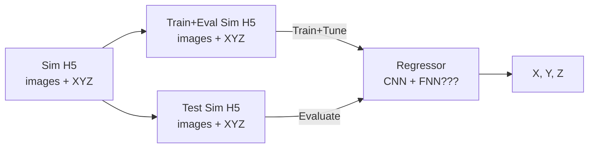
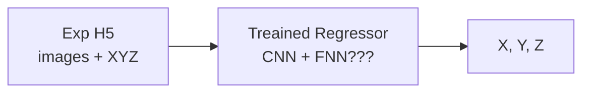
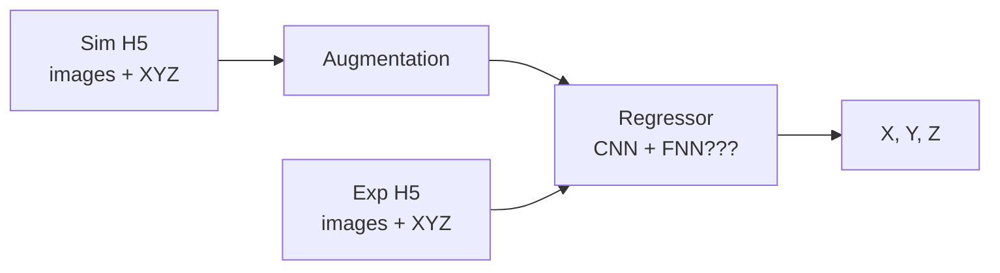
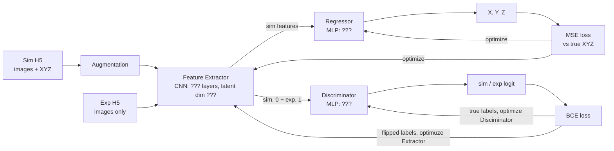

# Inverse_Spectrometer

## Introduction

Project 2 trains a neural network that maps an image to three continuous values (X, Y, Z). The network is trained on ~100,000 simulated images, which have labels, but it has to work on ~1,500 experimental images. Simulation and experiment look different (a domain gap), so the main challenge is making the model transfer from one to the other.

## Objective

Train and compare three models on the same backbone, split and seed:

1. **Baseline:** CNN feature extractor + regressor, trained on simulation only (MSE).
2. **Augmentation:** the same model, trained on augmented simulation data.
3. **Domain adaptation:** the same model plus a domain discriminator, trained adversarially so that simulated and experimental features become indistinguishable.

Evaluate each model on the simulated test set and on the experimental data, and compare how well each one closes the gap (error metrics and t-SNE of the latent space).

## Idea

### 1. Training and evaluate with simulation images

### 2. Evaluate with simulation images

### 3. Improve experimental evaluations via data augmentations

### 4. Improve experimental evaluations via domain adaptation

